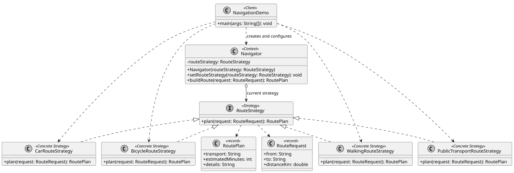
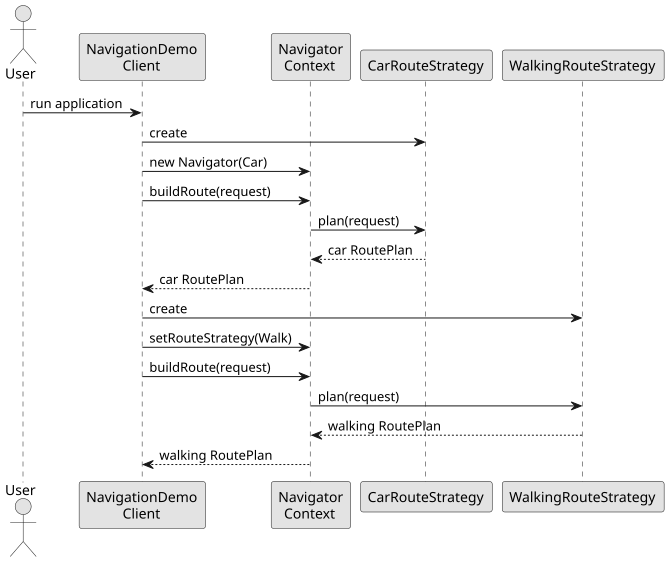

# Assignment 5 Strategy Pattern

Simple Java 17 example of the Strategy pattern for navigation. One `Navigator` can plan the same trip with car, walking, bicycle, or public transport algorithms and switch them at runtime.

## Run

Requirements: JDK 17+ and Maven 3.9+.

```bash
mvn test
mvn exec:java
```

## Structure

```text
src/main/java/.../strategy/
├── client/      NavigationDemo selects strategies
├── context/     Navigator delegates route planning
├── model/       RouteRequest and RoutePlan
└── strategy/    Interface and four algorithms
src/test/java/   JUnit 5 tests
docs/            UML diagrams, report, and defense notes
```

## Add a new strategy

1. Create a class that implements `RouteStrategy`.
2. Implement `plan(RouteRequest request)`.
3. Pass the new object to `Navigator` or `setRouteStrategy(...)`.

`Navigator` does not need to change. It contains no `if` or `switch` for strategy selection.

## UML





## Author

Amirkhan Tulkibayev, group SE-2522

Repository: <https://github.com/hann-qaz/Assignment_5_Strategy_Pattern>

